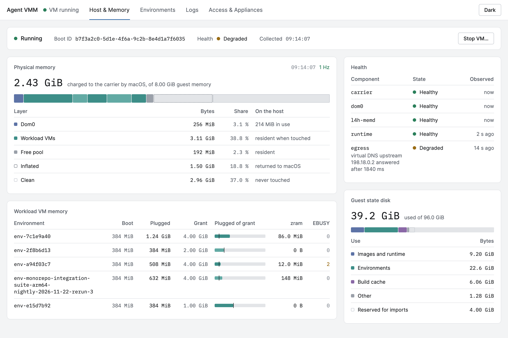
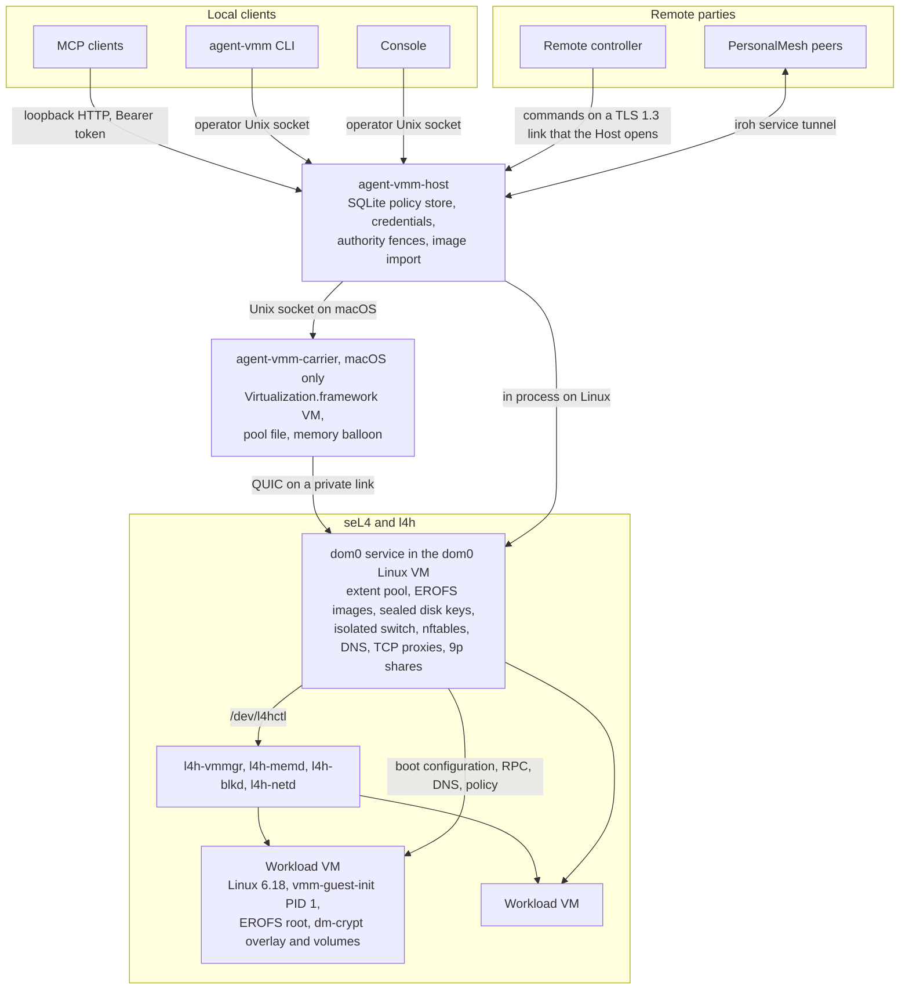
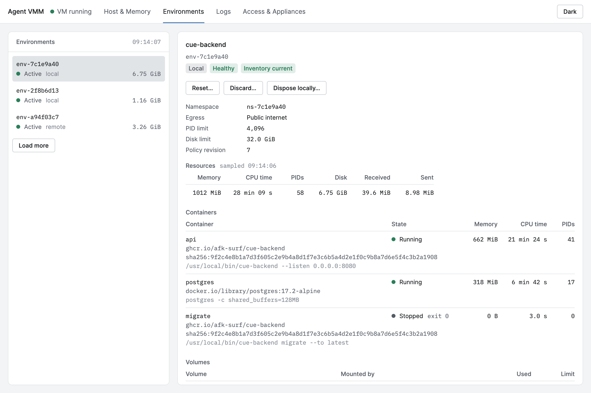
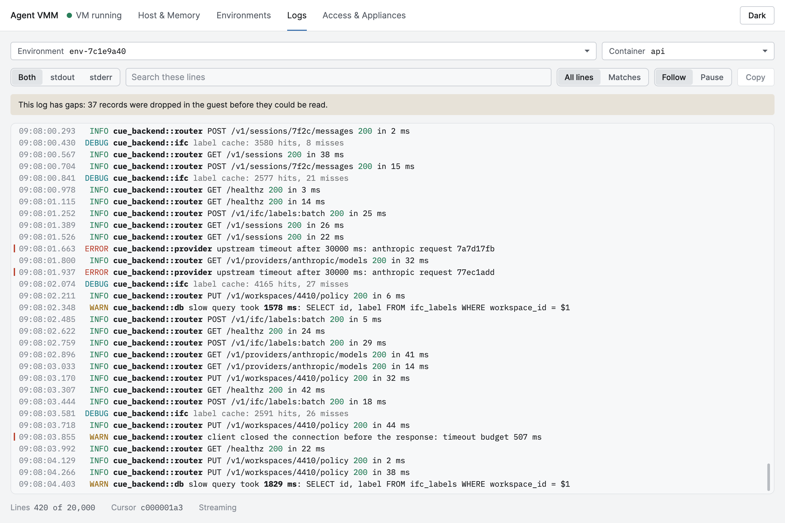
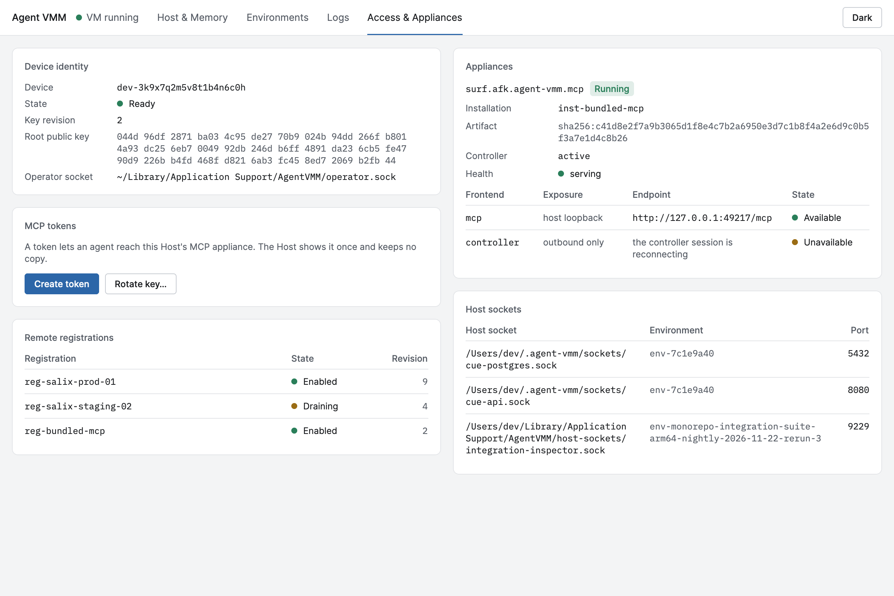

# Agent VMM

Agent VMM is a sandbox runtime for AI agent workloads.
It runs each workload in its own [l4h](third_party/l4h/README.md) Linux VM on the seL4 microkernel.
The Host keeps durable policy and gives each MCP client, operator, and remote controller a fenced scope.

<picture>
  <source media="(prefers-color-scheme: dark)" srcset="docs/assets/console/host-dark.png">
  <source media="(prefers-color-scheme: light)" srcset="docs/assets/console/host-light.png">
  
</picture>

## Capabilities

- **One VM for each workload**: Each container has its own l4h VM, Linux kernel, and `vmm-guest-init` PID 1.

- **Elastic memory**: By default, a workload VM boots with 384 MiB and plugs more memory on demand. `l4h-memd` owns the free memory. On macOS, a VirtIO balloon returns free memory to macOS.

- **Images**: The Host imports `linux/arm64` OCI images and prebuilt EROFS bundles. Each image becomes one read-only EROFS disk that workload VMs share.

- **Private storage**: Each root overlay and named volume is a dm-crypt ext4 disk in the dom0 extent pool. An operator-approved host directory reaches one environment through 9p2000.L.

- **Checked network**: The dom0 switch isolates each workload VM. Nftables, the dom0 DNS service, and TCP proxies apply egress and service route policy.

- **Control surfaces**: Each MCP token selects one environment for its workload tools. The operator CLI, the console, and the remote controller protocol manage the Host.

## Platforms

The project has no production release. Interfaces can change without notice.
This repository does not publish binaries.

| Platform | Status | Runtime |
| --- | --- | --- |
| macOS 15 or later, Apple Silicon | Primary platform | The Carrier runs seL4, l4h, and dom0 in one Virtualization.framework VM |
| Linux arm64 | Experimental | The Host runs in the dom0 of a native seL4 and l4h computer |
| Console in `apps/console` | Development tool | A macOS window, and Linux drawing without a window for tests |

The macOS package is `Agent VMM Host.app`. It contains the Host, `agent-vmm-carrier`, and the Guest bundle.
On macOS, the Carrier and `l4h-dom0d` connect through QUIC on a private link.
On Linux, the Host includes the dom0 service and uses `/dev/l4hctl` directly.
Workload VMs and Guest artifacts target Linux arm64.

## Architecture

The Host owns policy, credentials, and operation receipts in SQLite.
It selects the environment for each caller before it sends a request to dom0.
The dom0 service owns disk extents, disk keys, the switch policy, and the VM lifecycle.
The l4h components own memory, block devices, and virtual switches below dom0.
Dom0 can stop a VM or change its memory size. It cannot read the memory of a VM.

Read [the design overview](docs/design/overview.md) for owners, listeners, and lifetimes.

## Console

The console shows one Host to the people who build and debug Agent VMM.
Use MCP for workloads.

<table>
<tr>
<th width="33%">Environments</th>
<th width="33%">Logs</th>
<th width="33%">Access and appliances</th>
</tr>

<tr>
<td>

<picture>
<source media="(prefers-color-scheme: dark)" srcset="docs/assets/console/environments-dark.png">
<source media="(prefers-color-scheme: light)" srcset="docs/assets/console/environments-light.png">

</picture>

</td>
<td>

<picture>
<source media="(prefers-color-scheme: dark)" srcset="docs/assets/console/logs-dark.png">
<source media="(prefers-color-scheme: light)" srcset="docs/assets/console/logs-light.png">

</picture>

</td>
<td>

<picture>
<source media="(prefers-color-scheme: dark)" srcset="docs/assets/console/access-dark.png">
<source media="(prefers-color-scheme: light)" srcset="docs/assets/console/access-light.png">

</picture>

</td>
</tr>
</table>

Read [the console guide](apps/console/README.md) to run it.

## Get started

- [Quickstart](docs/quickstart.md): install a Host package and run a container.

- [Build and package](docs/build.md): build the Guest bundle and the Host package from source.

- [MCP workloads](docs/user/mcp.md): connect a client and use the tools.

- [Install and update](docs/operator/install-and-update.md): operate an installation.

## Documentation

- [Design overview](docs/design/overview.md), [runtime and storage](docs/design/runtime-and-storage.md), and [networking](docs/design/networking.md)

- [Security model](docs/design/security-model.md), [alternatives](docs/design/alternatives.md), and the [glossary](docs/glossary.md)

- [Operator CLI](docs/operator/cli.md), [cleanup](docs/operator/cleanup-and-local-resources.md), [backup](docs/operator/backup.md), and [troubleshooting](docs/operator/troubleshooting.md)

- [Remote protocol](docs/protocols/remote.md), [trust and service](docs/protocols/trust-service.md), and [appliances](docs/protocols/appliance.md)

- [API](docs/reference/api/README.md), [CLI commands](docs/reference/cli.md), [errors](docs/reference/errors.md), and [TLA+ models](spec/tla/README.md)

Read [SECURITY.md](SECURITY.md) for trust boundaries and vulnerability reports.
Read [CONTRIBUTING.md](CONTRIBUTING.md) before you send a change.

## License

The source uses `AGPL-3.0-or-later`. See [LICENSE](LICENSE) and [NOTICE](NOTICE).
Derived files retain the licenses listed in NOTICE.
