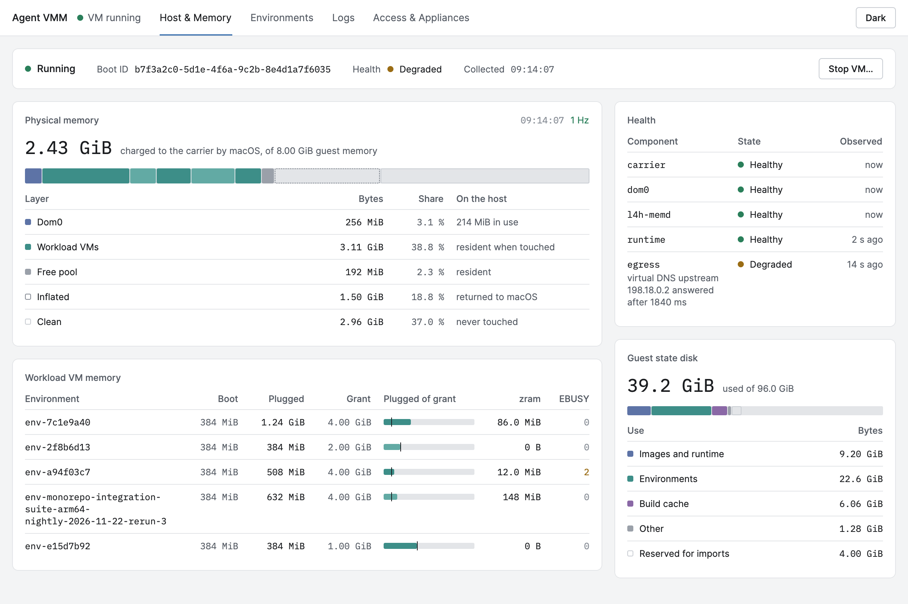
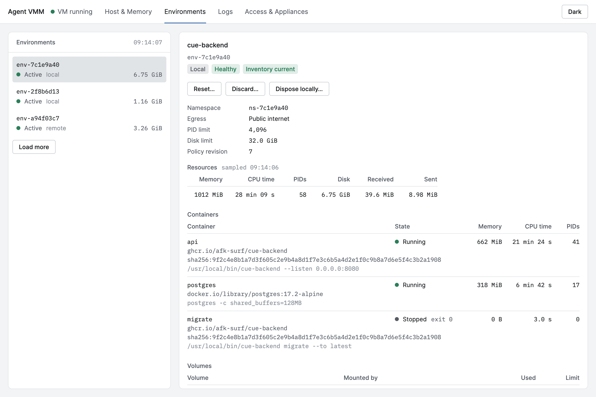
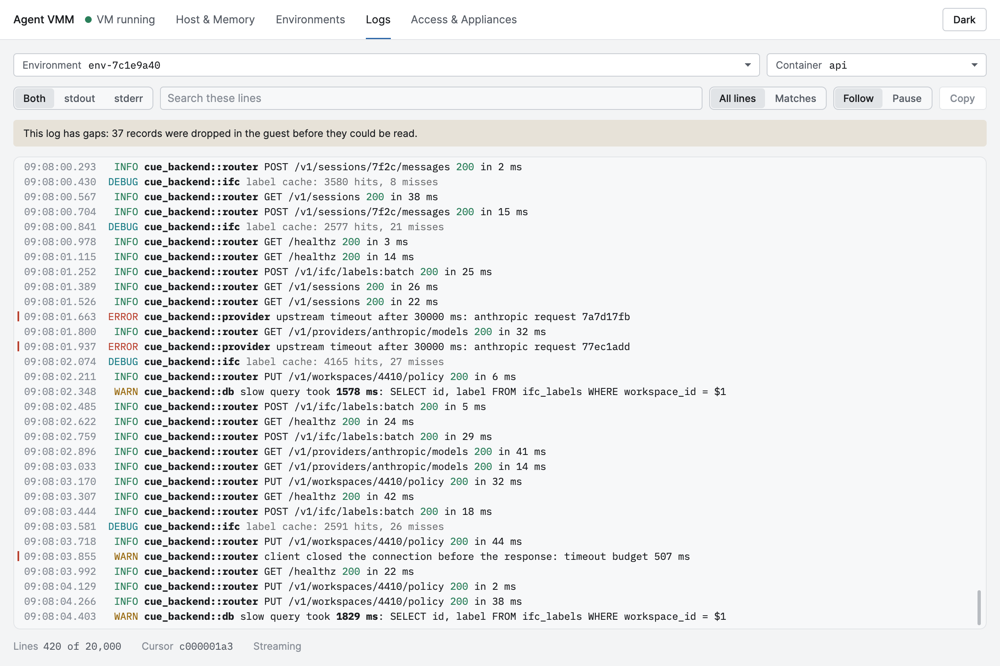
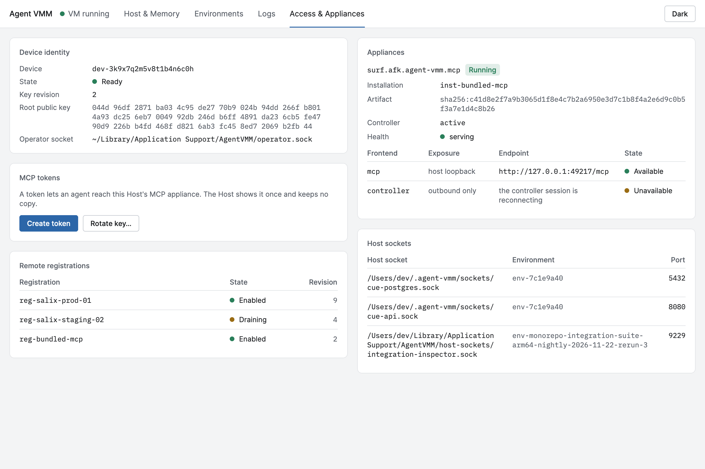

# Agent VMM console

A window on one Host for the people who build and debug Agent VMM.
It talks to the Host operator socket. It has no state of its own.

The console is a Cargo workspace of its own. The Host workspace excludes it, so the Host lock file, tests and notices do not include the UI dependencies.

| Crate | Content |
| --- | --- |
| `crates/console` | The application: four pages, the operator backend, the log viewer. |
| `crates/ui` | The GPU UI library. Read [`crates/ui/VENDOR.md`](crates/ui/VENDOR.md). |

## Overview

The pictures show the fixture Host. `scripts/media.sh picture` draws them with the real renderer.

### Host & Memory

The page shows the VM state, component health, and the state disk. It shows the physical memory layers and the memory of each environment.

<picture>
<source media="(prefers-color-scheme: dark)" srcset="../../docs/assets/console/host-dark.png">
<source media="(prefers-color-scheme: light)" srcset="../../docs/assets/console/host-light.png">

</picture>

### Environments

The page shows the policy, resources, containers, and volumes of one environment. It starts reset, discard, and local disposal.

<picture>
<source media="(prefers-color-scheme: dark)" srcset="../../docs/assets/console/environments-dark.png">
<source media="(prefers-color-scheme: light)" srcset="../../docs/assets/console/environments-light.png">

</picture>

### Logs

The page follows the output of one container. It filters the stream, searches the lines, and reports gaps.

<picture>
<source media="(prefers-color-scheme: dark)" srcset="../../docs/assets/console/logs-dark.png">
<source media="(prefers-color-scheme: light)" srcset="../../docs/assets/console/logs-light.png">

</picture>

### Access & Appliances

The page shows the device identity, registrations, appliances, and Host sockets. It creates MCP tokens and rotates the token key.

<picture>
<source media="(prefers-color-scheme: dark)" srcset="../../docs/assets/console/access-dark.png">
<source media="(prefers-color-scheme: light)" srcset="../../docs/assets/console/access-light.png">

</picture>

## Pages

| Page | Operator calls |
| --- | --- |
| Host & Memory | `GetVM`, `GetSystemHealthSummary`, `GetLocalDiskSummary`, `GetMemorySummary`, `GetVMImpactSummary`, `StartVM`, `StopVM`, `GetOperation` |
| Environments | `ListLocalEnvironmentPage`, `GetEnvironment`, `PlanResetEnvironment`, `PlanDiscardEnvironment`, `ExecuteCleanup`, `PlanLocalDisposal`, `ExecuteLocalDisposal` |
| Logs | `Logs` |
| Access & Appliances | `GetDeviceIdentity`, `ListLocalRegistrationPage`, `ListHostSockets`, `CreateMCPToken`, `RotateMCPTokenKey`, `ApplianceAdminService.ListAppliances`, `ApplianceAdminService.GetApplianceStatus` |

The Host page samples the Host one time each second while the page is in view.
`GetMemorySummary` gives the memory layers. An older Host without that call shows a note in their place.

## Fonts

`crates/console/assets/fonts` contains Inter and IBM Plex Mono. The console draws with these fonts on each platform. Text has the same measure in tests and on the screen.
Each font has the SIL Open Font License 1.1. The license texts are `Inter-OFL.txt` and `IBMPlexMono-OFL.txt` in that directory.

## Run

```sh
cargo run --release --bin agent-vmm-console
```

The console connects to `~/Library/Application Support/AgentVMM/operator.sock`.
Set `AGENT_VMM_HOST_SOCKET` to use another socket.

## Check

```sh
scripts/verify.sh
```

The script runs the format check, Clippy and the tests. The tests draw each page without a screen and audit the frame. On Linux they need `protoc`, the fontconfig development files and a Vulkan driver such as Mesa `lavapipe`.

## Pictures and film

```sh
scripts/media.sh picture out/
scripts/media.sh film out/
```

`picture` writes one PNG for each state, window size and theme.
`film` writes the frames of a walk through the pages and makes `console.mp4` from them. It needs `ffmpeg`.
Both draw the fixture Host with the real renderer. No Host is necessary.
