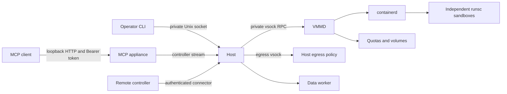

# Design overview

Agent VMM runs independent gVisor sandboxes in one Linux Guest.
The Host owns policy and durable product state. VMMD owns privileged Guest operations.
The Host supports Virtualization.framework on macOS and KVM on Linux arm64.

## Components and data flow

The appliance owns MCP tools, token-scoped allocations, and cleanup policy.
The connector maps one authenticated controller registration to its own allocations.
The data worker owns peer transport and endpoint keys. The Host owns trust and route authorization.
The Host restarts an exited data worker on the same sockets. Each worker start has a new endpoint key and generation.

## Local listeners

| Listener | Caller and authority |
| --- | --- |
| Operator Unix socket | Trusted local operator. Includes whole-VM and destructive operations. |
| Agent session Unix socket | One Host-selected environment and revocable runtime session. |
| Remote-compute Unix socket | One registration selected by its authenticated connector. |
| Trust Unix socket | Restricted connector proofs and registry work. |
| Service transport Unix socket | Authorized service streams. |
| Mesh-control Unix socket | Current personal route requests from the data worker. |

Internal sockets reside in private Host directories.
Read [the local threat model](../../SECURITY.md#local-threat-model) for MCP access and same-user boundaries.

## State owners

| State | Owner |
| --- | --- |
| Environments, registrations, grants, revocations, operation receipts | Host SQLite database |
| Device root signing key | Host Keychain or file key provider |
| Containers, tasks, snapshots, image content | containerd, mediated by VMMD |
| Named volumes and namespace project quotas | VMMD |
| Controller intent and command delivery | External controller |
| Personal mesh membership | Signed registry state verified by the Host |
| Peer transport keys and live connections | Data worker |
| Host installation, update, maintenance receipts | Lifecycle helper |

Host restart replays durable intent. It does not derive authority from old network rules or connector connections.
Linux Host restart adopts the running Guest. It preserves workloads unless their lifecycle owner requires retirement.

## What ends what

| Event | Ends | Preserves |
| --- | --- | --- |
| Controller disconnect or connection replacement | Old command authority and transport | Allocations, running workloads, private data |
| Runtime session replacement | Previous runtime capability and tunnel | Allocation and workload lifetime |
| Registration drain | New allocation admission | Existing allocations and sessions |
| Allocation release or registration revoke | Affected capabilities and workloads, after confirmed stop | Retained private data |
| Cleanup reset | Confirmed runtime objects under the selected plan | Named volumes and retained allocation |
| Cleanup discard or local disposal | Exact confirmed resources and owner records | Other environments, registrations, shared content, device identity |
| Appliance stop | That installation's runtime publication | Installation data and trust |
| Appliance revoke | That installation's authority and runtime publication | Data needed for explicit removal or recovery |
| Appliance remove | Confirmed installation domain and data | Other installations and the shared VM |
| Explicit VM stop | Every workload in the VM | Durable configurations, volumes, and desired state |
| Data worker exit | Peer connections, pairing sessions, the endpoint identity of that worker, and the current controller connection | Controller registration, allocations, workloads, and route authority |

A failed appliance activation affects that installation. It does not authorize changes to sibling workloads.
A version difference alone does not authorize deletion, re-enrollment, or workload termination.

Read [runtime and storage](runtime-and-storage.md), [networking](networking.md), and [the security model](security-model.md).
Remote command contracts are in [the remote protocol](../protocols/remote.md).
