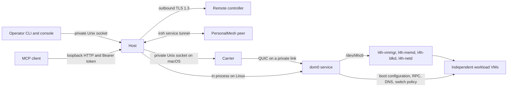

# Design overview

Agent VMM runs each workload in its own l4h VM on the seL4 microkernel.
The Host owns policy and durable product state.
The dom0 service owns privileged disk, network, and VM operations.
On macOS, the Carrier runs seL4, l4h, and dom0 in one Virtualization.framework VM.
On Linux arm64, the Host runs in the dom0 of a native seL4 and l4h computer.

## Components and data flow

The Host serves the MCP tools, the operator API, and the appliance administration API.
A connector in the Host maps one authenticated controller registration to its own allocations.
The Host selects the environment for each caller before it sends a request to dom0.
The Host imports images and sends each image to dom0 as one EROFS disk.

The dom0 service allocates disks from the extent pool and seals the disk keys.
It starts each workload VM through `/dev/l4hctl` with a read-only image disk and encrypted writable disks.
It serves the boot configuration, the DNS service, and the Host share ports at the switch gateway.
`vmm-guest-init` is PID 1 in each workload VM. It assembles the root filesystem and serves the Guest RPC.

The l4h components below dom0 own memory, block devices, and virtual switches.
Dom0 can stop a VM or change its memory size. It cannot read the memory of a VM.

## Platform paths

On macOS, `agent-vmm-carrier` holds the virtualization entitlement and owns the VM.
The VM boots one image that contains the seL4 loader, seL4, l4h, and the dom0 kernel.
The pool file `pool.raw` is the first VM disk. The read-only dom0 root filesystem is the second disk.
The Carrier and `l4h-dom0d` use QUIC on a point-to-point link for control, Guest relay, and Host share streams.
A VirtIO balloon returns memory that `l4h-memd` holds free to macOS.

On Linux arm64, the Host opens the pool and `/dev/l4hctl` in its own process.
It reads the dom0 configuration from `dom0.json` in the instance directory.
The same `vmm-dom0` code serves both platforms.

## Listeners

| Listener | Caller and authority |
| --- | --- |
| Operator Unix socket | Trusted local operator, with whole-VM and destructive operations |
| MCP loopback HTTP port | One environment for each issued Bearer token |
| Carrier Unix socket, macOS | The Host, for VM control and dom0 streams |
| Dom0 QUIC port, macOS | The Carrier, on the private link |

| Listener | Caller and authority |
| --- | --- |
| Dom0 boot, DNS, and share ports | One workload VM, selected by its switch address |
| Guest RPC port | The dom0 service, with the RPC token of that boot |
| Host iroh endpoint | Peers with an authorized service route |

Unix sockets reside in private Host directories with mode 0600.
Read [the local threat model](../../SECURITY.md#local-threat-model) for MCP access and same-user boundaries.

## State owners

| State | Owner |
| --- | --- |
| Environments, registrations, grants, revocations, operation receipts | Host SQLite database |
| Device root signing key and credentials | Host Keychain or file key provider |
| Extent allocations, sealed disk keys, boot records, service routes | Dom0 pool database |
| Image, root overlay, and volume content | Dom0 extent pool |

| State | Owner |
| --- | --- |
| Free memory and the memory blocks of each VM | `l4h-memd` |
| Processes, logs, and mounts of one workload | `vmm-guest-init` in that workload VM |
| Controller intent and command delivery | External controller |
| Personal mesh membership | Signed registry state verified by the Host |

The lifecycle helper owns Host installation, update, and maintenance receipts.

Host restart replays durable intent. It does not derive authority from old network rules or connector connections.
Host restart adopts the running workload VMs. It preserves workloads unless their lifecycle owner requires retirement.
On macOS, the Carrier and its VM continue to run while the Host restarts.

## What ends what

Controller and session events:

| Event | Ends | Preserves |
| --- | --- | --- |
| Controller disconnect or connection replacement | Old command authority and transport | Allocations, running workloads, private data |
| Runtime session replacement | Previous runtime capability and tunnel | Allocation and workload lifetime |
| Registration drain | New allocation admission | Existing allocations and sessions |
| Allocation release or registration revoke | Affected capabilities and workloads, after confirmed stop | Retained private data |

Cleanup and VM events:

| Event | Ends | Preserves |
| --- | --- | --- |
| Cleanup reset | Confirmed runtime objects under the selected plan | Named volumes and retained allocation |
| Cleanup discard or local disposal | Exact confirmed resources and owner records | Other environments, registrations, shared content, device identity |
| Explicit VM stop | Every workload VM of the Host | Durable configurations, volumes, and desired state |

Appliance events:

| Event | Ends | Preserves |
| --- | --- | --- |
| Appliance stop | Runtime publication for that installation | Installation data and trust |
| Appliance revoke | Authority and runtime publication for that installation | Data needed for explicit removal or recovery |
| Appliance remove | Confirmed installation domain and data | Other installations |

A failed appliance activation affects that installation. It does not authorize changes to sibling workloads.
A version difference alone does not authorize deletion, re-enrollment, or workload termination.

Read [runtime and storage](runtime-and-storage.md), [networking](networking.md), and [the security model](security-model.md).
Remote command contracts are in [the remote protocol](../protocols/remote.md).
